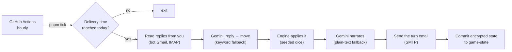

# Daily Dungeon

A solo Dungeons & Dragons adventure played over email, one turn a day.

Every morning an email arrives with what happened since your last move, where your hero
stands, and what's in the room with them. Reply in plain words: _"attack the rat"_,
_"sneak past and go east, stealth 14"_, _"drink a potion and search the room"_. The next
morning's email plays your reply and tells you how it went.

- **The engine decides everything.** A small, deterministic 5e-lite engine (three martial
  classes, the six-room _Sunken Vault_ campaign) resolves every attack, check and step.
- **Roll your own dice, or don't.** Put your totals in your reply and they're used as given.
  Leave them out and the engine rolls for you. Monsters always roll their own, and every
  roll is listed in the email.
- **Gemini reads and narrates.** Your free-text reply is turned into a structured move, and
  the outcome is written up as a short paragraph. Without a key, a keyword parser and the
  engine's plain sentences take over.
- **Runs on GitHub Actions.** No server: an hourly workflow plays the turn once a day at your
  delivery time and keeps the game, encrypted, on a `game-state` branch.

Forked from [Daily Scribe](https://github.com/RonanOD/dailyscribe) by Ronan O'Driscoll,
which emails Kindle Scribe users a daily PDF and reads back their handwriting. This fork
keeps its D&D engine and swaps the Kindle/PDF/handwriting loop for plain email.

## How a day works



- **Pacing:** your latest reply before the daily run is the one that's played, so you can
  correct a typo by replying again. Want to play several turns in one sitting? Run the
  workflow by hand with **force** after each reply.
- **Quiet days:** with no reply, nothing is sent. After 3 quiet days you get a single
  "your adventure awaits" reminder, then silence until you reply.
- **Unclear replies:** if your reply can't be read as a move, nothing happens in the game.
  The next email says what wasn't understood.
- **Endings:** death and victory are recorded, and the next reply rolls up a new hero.
  Reply **restart** at any time to retire your hero and start over.

## Setup

See **[SETUP.md](./SETUP.md)**. In short: a bot Gmail account with an app password, an
optional Gemini key, an encryption key, a few GitHub secrets, then enable Actions and run the
workflow once.

## Commands

```bash
pnpm install
pnpm test            # unit tests
pnpm typecheck
pnpm preview --offline --reply "Brakka, barbarian"   # play locally, writes out/*.html
pnpm tick --dry-run --force                          # read the real inbox, print the email, change nothing
pnpm state show                                      # decrypt and print the saved game
```

## Layout

| Path                               | What it owns                                                                     |
| ---------------------------------- | -------------------------------------------------------------------------------- |
| `src/engine/`                      | The pure game: campaign, 5e-lite rules, turn engine, seeded dice.                |
| `src/ai/`                          | Gemini client, reply parser (+ keyword fallback), narrator.                      |
| `src/mail/`                        | Gmail IMAP/SMTP mailbox, quoted-reply stripping, DMARC check.                    |
| `src/email/`                       | Gmail-safe HTML + plain-text turn emails, table-drawn fog-of-war map.            |
| `src/store/`                       | AES-256-GCM encrypted state file.                                                |
| `src/tick.ts`                      | The daily run that ties it together. `src/cli.ts` exposes it as `pnpm` commands. |
| `.github/workflows/daily-turn.yml` | The hourly schedule and the `game-state` branch commit.                          |

## License

[GNU AGPLv3](./LICENSE), inherited from Daily Scribe.
